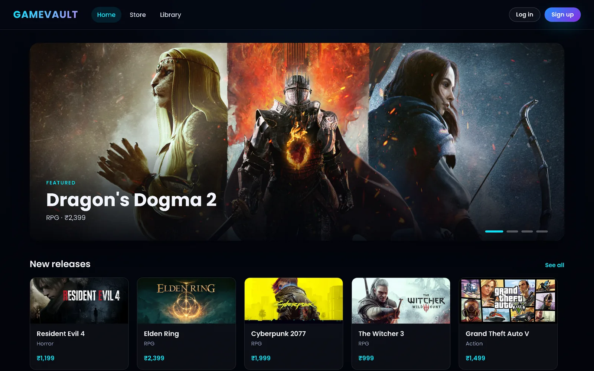
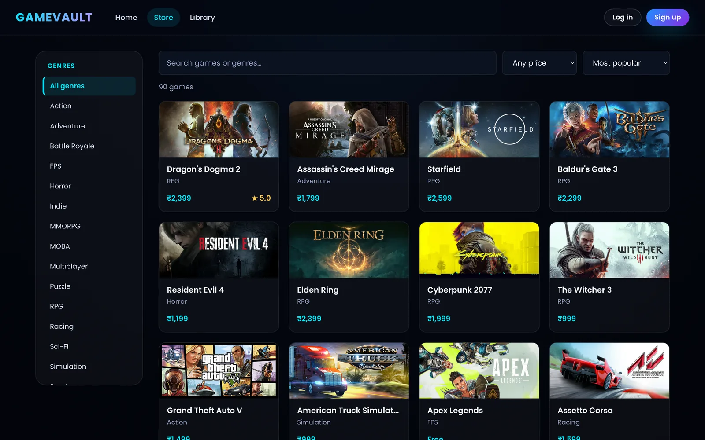
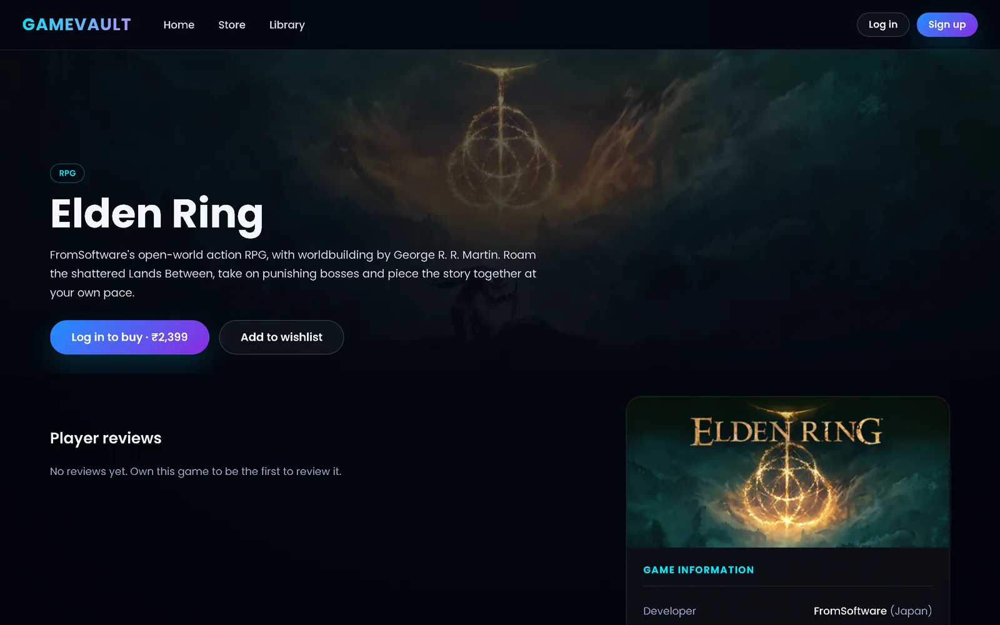
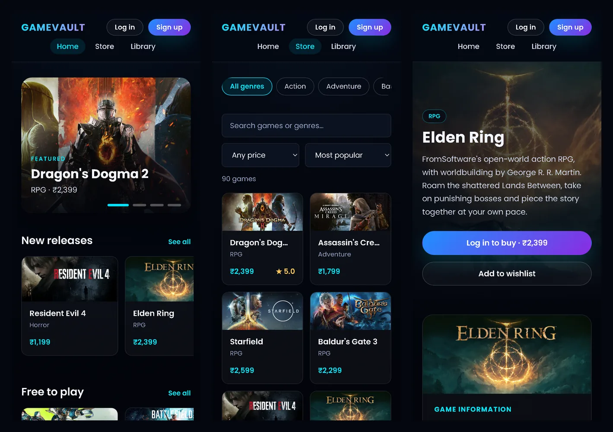
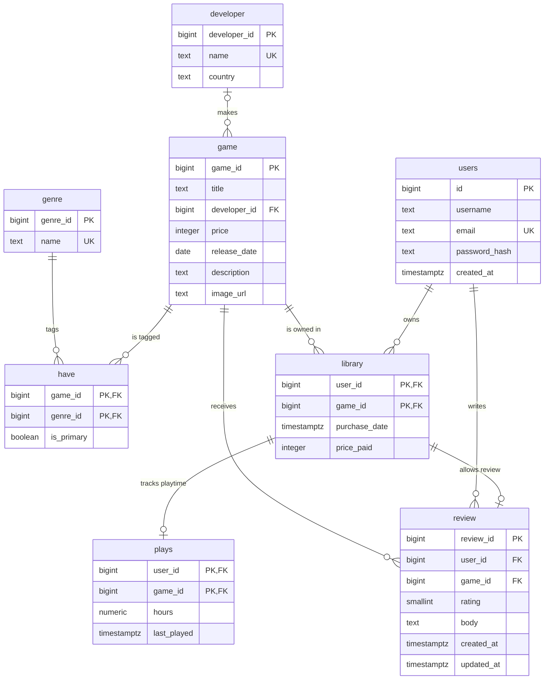

# GameVault

[](LICENSE)
[](CONTRIBUTING.md)
[](https://github.com/NotADIM2/GameVault/actions/workflows/checks.yml)

A digital game store and library built with Flask and Supabase (PostgreSQL). Browse a catalog of 90 games, buy or add free games to your library, and leave reviews for the games you own.



> **New to open source? Start here.** You can add a game to GameVault in about five minutes, straight from your browser. You don't need to install anything, set up a database or know Python. [See how ↓](#your-first-contribution-no-setup)

## Screenshots

| Store | Game page |
|---|---|
|  |  |



## Features

- **Store** – search, filter by genre and price, and sort by popularity, rating, release date or price. Filters are kept in the URL, so any view can be shared.
- **Game pages** – details, developer, ratings and player reviews. Ratings and owner counts are calculated from real rows in the database.
- **Accounts** – sign up and log in with hashed passwords.
- **Library** – the games you own, with purchase date, price paid and last played.
- **Reviews** – only owners of a game can review it; this is enforced by the database.

## Tech stack

| Layer | Technology |
|---|---|
| Backend | Python 3.11+, Flask |
| Database | Supabase (PostgreSQL) |
| Frontend | Jinja templates, plain CSS and JavaScript |

## Getting started

> Only needed if you want to run the app or change its code. **To add or fix games, skip this** and see [Your first contribution](#your-first-contribution-no-setup).

### 1. Install dependencies

```bash
git clone https://github.com/NotADIM2/GameVault.git
cd GameVault
python -m venv .venv
.venv\Scripts\activate        # macOS/Linux: source .venv/bin/activate
pip install -r requirements.txt
```

### 2. Create the database

1. Create a project at [supabase.com](https://supabase.com).
2. Open the SQL editor, paste the contents of `supabase/schema.sql` and run it.

### 3. Configure the environment

Copy `.env.example` to `.env` and fill it in:

| Variable | Value |
|---|---|
| `SUPABASE_URL` | Your project URL (Project Settings → API) |
| `SUPABASE_KEY` | The **service_role** (secret) key. The anon key will not work, because Row Level Security is enabled on every table. |
| `SECRET_KEY` | A random string for signing sessions: `python -c "import secrets; print(secrets.token_hex(32))"` |
| `SESSION_COOKIE_SECURE` | `1` when serving over HTTPS, otherwise `0` |

Never commit `.env`. The service_role key bypasses all database security, so it must stay on the server.

### 4. Load the catalog and run

```bash
python -m scripts.seed
python app.py
```

Open http://127.0.0.1:5000. Set `FLASK_DEBUG=1` in `.env` for auto-reload while developing.

To test the library and reviews without registering and buying games by hand, run `python -m scripts.seed --demo` instead. It also creates two sample accounts, `player@gamevault.test` and `critic@gamevault.test`, with the password `gamevault-demo`. They own, play and review a few games. Only use `--demo` on your own development project, never on a live site, because anyone can read that password here.

On GitHub, the **Seed** workflow re-runs the seed whenever a change to `data/` lands on `main`, so merged games appear without a manual step. It reads `SUPABASE_URL` and `SUPABASE_KEY` from the `catalog-seed` environment's secrets (Settings → Environments), which only the `main` branch can use. You can also start it by hand from the Actions tab.

## Project structure

```
app.py                 Entry point
backend/
  __init__.py          App factory, config, CSRF protection, template filters
  db.py                Supabase client
  queries.py           All database access
  routes/              main (home, store, game), auth, shop (buy, library, reviews)
data/
  games/               The catalog: one JSON file per game
  developers/          One JSON file per studio
scripts/
  check_catalog.py     Validates the catalog (runs on every pull request)
  seed.py              Loads the catalog into Supabase (safe to re-run; --demo adds sample users)
supabase/schema.sql    Tables, views, purchase function and security rules
templates/             Jinja templates
static/                CSS, JavaScript and images
```

## Database design

- **Entities:** `users`, `developer`, `game`, `genre`
- **Relations:** `have` (game ↔ genre), `library` (user owns game), `plays` (playtime), `review`
- **Views:** `game_catalog` and `user_library` supply everything the pages read.
- **Purchases** run through the `purchase_game` function, so a purchase is a single transaction.

The Flask server is the only client of the database. Row Level Security is enabled with no policies, so the public anon key can read and write nothing.



## Development

```bash
python scripts/check_catalog.py   # checks the catalog
pip install ruff
ruff check .                      # lints the Python code
```

Both also run automatically on every pull request.

## Contributing

Contributions of any size are welcome, from fixing one release date to building a whole feature. First-timers are very welcome.

### Your first contribution (no setup)

All you need is a free GitHub account.

1. Pick a task from the [project board](https://github.com/users/NotADIM2/projects/3) or the [good first issues](https://github.com/NotADIM2/GameVault/issues?q=is%3Aopen+label%3A%22good+first+issue%22), and comment "I'll take this" so nobody else does the same work.
2. Every game is its own small file in [`data/games/`](data/games). To add a game, open that folder and click **Add file → Create new file**. To fix one, open its file and click the **pencil icon**. GitHub makes your own copy (a fork) automatically.
3. Make your change. The [catalog format](CONTRIBUTING.md#adding-a-game) shows an example game, and the issues give you the exact file name to use.
4. Click **Commit changes...**, then **Propose changes**, then **Create pull request**.

[CONTRIBUTING.md](CONTRIBUTING.md#editing-in-your-browser) has the same steps in more detail.

### You can't break anything

- **Nothing changes until it's reviewed.** Your pull request is only a suggestion. The live project stays exactly as it is until a maintainer reviews and merges it.
- **Mistakes get caught for you.** An automatic check tests every pull request and tells you in plain words what to fix, for example a missing comma on line 412, or a date that isn't `YYYY-MM-DD`. Fix it in the same pull request and the check runs again.
- **No keys or passwords involved.** Contributors never need access to the database or any secrets.
- **Questions are fine.** Not sure about something? Open the pull request anyway and ask in it, or [open an issue](https://github.com/NotADIM2/GameVault/issues/new/choose).

Once your pull request is merged, you show up in the repository's contributors list.

### Good first contributions

No setup needed: these only change files in [`data/`](data).

| Task | Issue |
|---|---|
| **Add games from a themed list**: 150 games to add, from indie favourites to fighting games, each with its id reserved | [Add games issues](https://github.com/NotADIM2/GameVault/issues?q=is%3Aopen+label%3Acatalog+%22Add+games%22) |
| **Add your favourite game** to the catalog | [#9](https://github.com/NotADIM2/GameVault/issues/9) |
| **Write descriptions and release dates**: 80 of 90 games are missing them, split into batches by genre | [#2](https://github.com/NotADIM2/GameVault/issues/2) · [#3](https://github.com/NotADIM2/GameVault/issues/3) · [#4](https://github.com/NotADIM2/GameVault/issues/4) · [#5](https://github.com/NotADIM2/GameVault/issues/5) · [#6](https://github.com/NotADIM2/GameVault/issues/6) |
| **Find artwork** for Genshin Impact, Honkai: Star Rail and Alan Wake 2 | [#7](https://github.com/NotADIM2/GameVault/issues/7) |
| **Replace the 6 fictional titles** (ids 75–80) with real games | [#8](https://github.com/NotADIM2/GameVault/issues/8) |

### Feature ideas

These need the app running (see [Getting started](#getting-started)).

| Feature | Issue |
|---|---|
| Wishlist stored in the database (it currently lives in the browser) | [#10](https://github.com/NotADIM2/GameVault/issues/10) |
| Cart and a mock checkout with order history | [#11](https://github.com/NotADIM2/GameVault/issues/11) |
| A "Your stats" page: hours and spending by genre | [#12](https://github.com/NotADIM2/GameVault/issues/12) |
| Recommendations ("because you own X") from shared genres | [#13](https://github.com/NotADIM2/GameVault/issues/13) |
| Full-text search with PostgreSQL | [#14](https://github.com/NotADIM2/GameVault/issues/14) |
| Rate limiting for login and sign-up | [#16](https://github.com/NotADIM2/GameVault/issues/16) |
| Automated tests for the routes and database queries | open an issue |

There are more tasks for frontend, backend, database and docs on the [project board](https://github.com/users/NotADIM2/projects/3), and you can filter issues by the `catalog`, `frontend`, `backend` and `database` labels.

Have your own idea? [Suggest a feature](https://github.com/NotADIM2/GameVault/issues/new/choose). For a large feature, comment on the issue before starting so we can agree on the approach first.

## Notes

- Purchases are simulated; there is no payment processing.
- Game artwork is loaded from the Steam CDN and belongs to its respective owners.

## License

[MIT](LICENSE)
